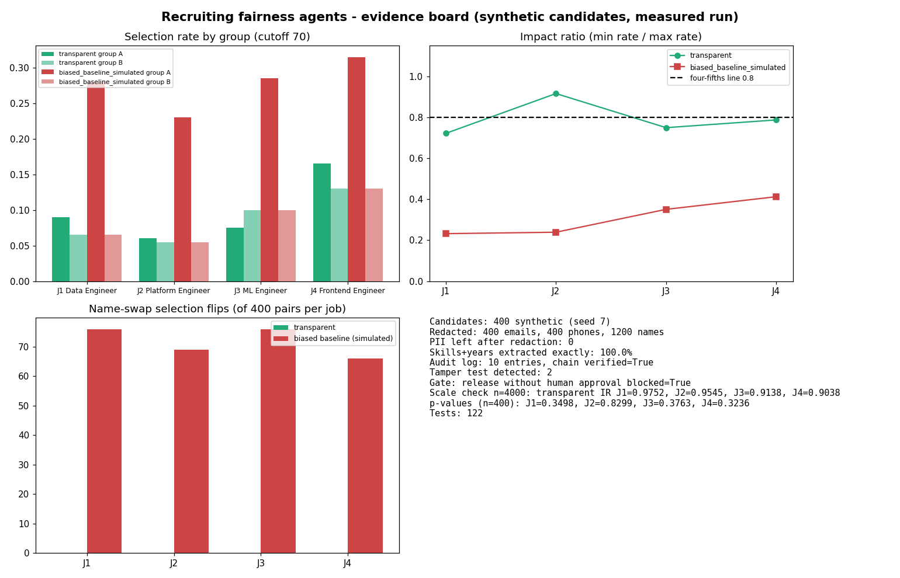
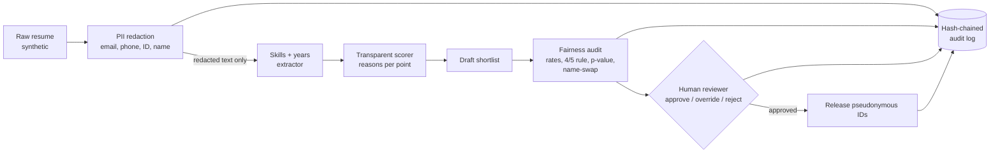

# Jagadish-recruiting-fairness-agents

**Recruiter summary.** Hiring is a high-risk use of AI: a matcher that quietly learns a name proxy can screen out a whole group. This repo builds the recruiting pipeline for **Brightwell Staffing** (a fictional staffing firm) the careful way: personal details are stripped before anything reads a resume, every match score is broken into written reasons that add up to the number, a fairness audit measures selection rates by group, applies the four-fifths rule and swaps names to see whether anything moves, and no shortlist leaves without a named human approving it. Every step lands in a hash-chained audit log. All data is synthetic and every number below comes from a real local run.

<!-- BEGIN:headline -->
| What | Measured (synthetic data, seed 7) |
|---|---|
| Candidates | 400 (scale check 4000) |
| PII redacted before scoring | 400 emails, 400 phones, 1200 name mentions; 0 left |
| Skills + years extracted exactly | 100.0% |
| Transparent scorer impact ratio, n=400 | J1 0.7222, J2 0.9167, J3 0.75, J4 0.7879 |
| Transparent scorer impact ratio, n=4000 | J1 0.9752, J2 0.9545, J3 0.9138, J4 0.9038 |
| Biased baseline (simulated) impact ratio, n=4000 | J1 0.3214, J2 0.3348, J3 0.3302, J4 0.4379 |
| Name-swap selection flips, transparent / baseline | J1 0 / 76, J2 0 / 69, J3 0 / 76, J4 0 / 66 |
| Release without human approval | blocked = True; override with written reason used = True |
| Audit log | 10 entries, chain verified = True; edited entry detected at seq 2 |
| Tests | 122 |
<!-- END:headline -->



## What the numbers say
- The **transparent scorer** never sees the name, so the name-swap check finds **0 score changes and 0 selection flips** on all four jobs.
- The **biased baseline is simulated on purpose**: it adds 15 points when the first name comes from pool A. The audit catches it on every job (impact ratio far under 0.8, p < 0.01, dozens of flips).
- **Known, kept-visible miss:** at 400 candidates, three of the four transparent jobs dip under the four-fifths line from sampling noise alone (p > 0.3, gap not significant). At 4,000 candidates all four sit above 0.9. That is why the gate asks a human for a written override instead of auto-passing or auto-blocking, and why the rule is never the only test.

<!-- BEGIN:jobs -->
| Job | Scorer | Selected A / B (of 200 each) | Impact ratio | Four-fifths | p-value | Name-swap flips (of 400) |
|---|---|---|---|---|---|---|
| J1 Data Engineer | transparent | 18 / 13 | 0.7222 | FAIL | 0.3498 | 0 |
| J1 Data Engineer | biased baseline (simulated) | 56 / 13 | 0.2321 | FAIL | 0.0 | 76 |
| J2 Platform Engineer | transparent | 12 / 11 | 0.9167 | pass | 0.8299 | 0 |
| J2 Platform Engineer | biased baseline (simulated) | 46 / 11 | 0.2391 | FAIL | 0.0 | 69 |
| J3 ML Engineer | transparent | 15 / 20 | 0.75 | FAIL | 0.3763 | 0 |
| J3 ML Engineer | biased baseline (simulated) | 57 / 20 | 0.3509 | FAIL | 0.0 | 76 |
| J4 Frontend Engineer | transparent | 33 / 26 | 0.7879 | FAIL | 0.3236 | 0 |
| J4 Frontend Engineer | biased baseline (simulated) | 63 / 26 | 0.4127 | FAIL | 0.0 | 66 |
<!-- END:jobs -->

## Architecture


## Docs
| Doc | What it covers |
|---|---|
| [docs/purpose.md](docs/purpose.md) | Purpose and audience |
| [docs/architecture.md](docs/architecture.md) | Components and data flow |
| [docs/how-it-works.md](docs/how-it-works.md) | Step by step |
| [docs/code-and-output.md](docs/code-and-output.md) | Real code excerpts and their real output |
| [docs/running.md](docs/running.md) | How to run it |
| [docs/guardrails.md](docs/guardrails.md) | Guardrails and security controls |
| [docs/limitations.md](docs/limitations.md) | Limitations and known failures |
| [docs/model-card.md](docs/model-card.md) | Model card |
| [docs/risk-notes.md](docs/risk-notes.md) | Risk notes: EU AI Act high-risk, NIST AI RMF, US adverse-impact practice |
| [docs/threat-model.md](docs/threat-model.md) | STRIDE and LLM-era threats |
| [docs/implementation-guide.md](docs/implementation-guide.md) | Guide for adopters |
| [docs/interview-points.md](docs/interview-points.md) | Talking points |
| [docs/results.md](docs/results.md) | Full results.json |
| [docs/adr/](docs/adr/) | Decisions |

## Quick start (offline, free)
```bash
pip install -e ".[dev]"
pytest -q
recfair demo --board          # writes results/results.json, audit_log.jsonl, evidence_board.png
python scripts/render_docs.py # refresh the numbers in the docs
```

## Built vs planned
| Item | Status |
|---|---|
| Synthetic candidates and jobs (two invented name pools, same qualification distribution) | Built |
| PII redaction before scoring, logs and errors (SafeError, redacting log filter) | Built |
| Keyed HMAC pseudonymous candidate IDs | Built |
| Alias-aware skills and years extraction | Built |
| Transparent scorer with reasons that sum to the score | Built |
| Simulated biased baseline to prove the audit works | Built |
| Selection rates, Wilson intervals, four-fifths rule, two-proportion p-value | Built |
| Counterfactual name-swap check | Built |
| Human sign-off state machine with written override | Built |
| Hash-chained audit log with tamper detection | Built |
| Evidence board PNG | Built |
| CI: ruff, tests, printed test count, doc drift check, hashed brand check, gitleaks, CodeQL | Built |
| Intersectional groups, more than two groups, proxies beyond names (school, postcode, gaps) | Planned |
| LLM-based extraction with schema validation (would be compared against this rule baseline) | Planned |
| Candidate notice and appeal flow, reviewer UI | Planned |
| Cloud deployment | Not planned (stays free and local) |

## Related repos
- [Jagadish-pii-guard](https://github.com/jagadishmazure-jpg/Jagadish-pii-guard): deeper PII detection with checksum validators.
- [Jagadish-agentic-ai-model-risk](https://github.com/jagadishmazure-jpg/Jagadish-agentic-ai-model-risk): model risk management that this model card plugs into.
- [Jagadish-llm-evals-observability](https://github.com/jagadishmazure-jpg/Jagadish-llm-evals-observability): eval gates and tracing.
- [Jagadish-confidence-calibrated-autonomy](https://github.com/jagadishmazure-jpg/Jagadish-confidence-calibrated-autonomy): when an agent should hand off to a person.

<!-- BEGIN:tests -->
**122 tests**
<!-- END:tests -->, all offline. MIT licensed. Names, people and the firm are fictional.
