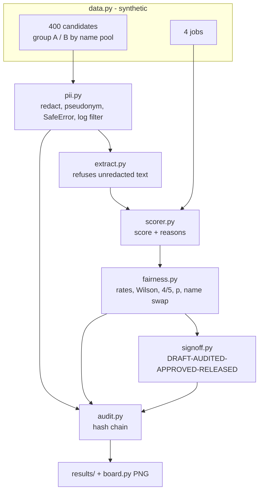

# Architecture

| Module | Responsibility | Reads the group label? |
|---|---|---|
| `data.py` | Synthetic candidates and jobs, name swap helper | creates it |
| `pii.py` | Redaction, HMAC pseudonyms, safe errors and logs | no |
| `extract.py` | Skills (with aliases) and years from redacted text | no |
| `scorer.py` | Transparent score; simulated biased baseline | no (baseline reads the raw first name on purpose) |
| `fairness.py` | Audit metrics | yes, only here |
| `signoff.py` | Human gate state machine | no |
| `audit.py` | Append-only hash-chained log | no |
| `pipeline.py`, `cli.py`, `board.py` | Orchestration, demo, evidence board | via results |

Design choice: the group label is joined to pseudonymous IDs only inside the audit, so the scorer cannot use it even by accident. See [ADR 0001](adr/0001-rules-scorer-first.md) and [ADR 0002](adr/0002-human-override-not-auto-block.md).
